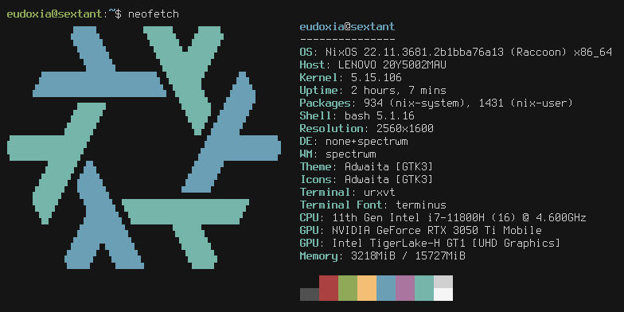
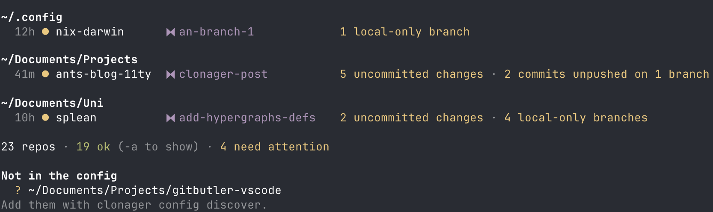
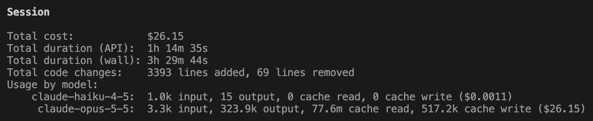

## NixOS

I love storing state in version control, because I [never trust myself](../2026-08-15-github-verified-linear/), and I want to be able to [configure fearlessly](../2024-12-28-code-fearlessly/).
So I love Django's migration system, producing documents with LaTeX, [OpenTofu](https://opentofu.org) (formerly Terraform), and I was very taken with [NixOS](https://nixos.org).

The promise is a beautiful one: your whole device configuration lives in version controlled text files.
User interface, installed software, app configuration, everything.

I gave it a shot for a month or so, but unfortunately I just wasn't ready for Linux yet.
There were some macOS apps and niceties which I couldn’t find a replacement for quick enough to make the change stick.
Also, managing all the config was a little laborious, and documentation wasn’t amazing.

## nix-darwin

Then I discovered [nix-darwin](https://github.com/nix-darwin/nix-darwin), which brings the same concepts (with more limited abilities) to macOS, and found a happy medium.

Coupled with the recent advances in AI, this means that now my laptop's config is tended to by my personal genie.
I know there are all sorts of ways to have an agent directly control a device, but I’m not brave (stupid?) enough for those (yet?).
Instead, I talk to an agent with write permissions scoped to a single folder, review its changes in code, and then decide whether to run them on my laptop.
A perfect workflow!

I started by just listing all the software I wanted installing, and doing simple config on tools which allowed it (mainly CLI's).
Then I started getting Claude to manipulate GUI apps, by modifying their internal `.plist` files.
I built a very tailored workspace management config with [SketchyBar](https://github.com/felixkratz/sketchybar), [AeroSpace](https://github.com/nikitabobko/AeroSpace), and [ExtraDock](https://extradock.app).
And, before long, I was resigning un-notarised apps with local certificates, storing secrets in-repo with age keys synced from my 1Password vault, and having Python scripts configure applications through their MCP server (because in 2026 they add AI interfaces, before simple text file configs)!

## clonager

The last hurdle to tackle, to make wiping my computer a non-issue, was my files.
Everything is in Google Drive or git.
That sounds like everything is sorted, but my git repos need a bit of help.

I have about 30 on my laptop currently, and they all have various types of local-only data.
Some have uncommitted changes, some commits are unpushed, some diffs are sitting in stashes waiting to be applied.
I needed a tool which knew where all my repos were, and showed me where I had data which only existed locally.

I couldn't find it, so I built it (vibed it? product managed it?).

I gave Claude the idea, and it produced a working version very quickly.
I spent about 4h playing with the tool, and fine-tuning the details.
It integrates with [GitButler](https://gitbutler.com) and the [GitHub CLI](https://cli.github.com) to surface lots of different kind of data in a single cohesive interface.

It tells me where there is vulnerable data that I need to push somewhere.
It tells me when there are already merged branches which I can now delete.
It prints deep links to the terminal, which open repositories in VS Code and GitButler.

Because all the code was written by Claude, I felt nervous letting it touch my files, so it has a whitelist of git commands which only read data, and anything it wants to do which would need to write, it just prints the commands out for the user to run.

It also stores the locations of my different repos in a config file (automatically generated and maintained) which I can then use to replicate my whole directory structure onto a new machine!

I wiped my laptop, and got back to basically the same setup within an hour!

## AI development

For the first time ever, I have no idea how this all works.
It’s written in Go, a language I have never used.
If I look at a file, I can generally interpret what it is doing, but I’m not familiar with the structure of a Go project, or its best practices.

It’s a very strange feeling.
When I see people in charge of big companies saying that they don’t read the code their pushes to production, I still think to myself ‘what an idiot’.
But a year ago, when I saw people saying they were using AI-written code at all, as opposed to reading the slop and using it to motivate their own better solution, I thought similar.
So I’m probably wrong this time.

The AI’s truly are starting to out-perform us.
In any specific context, there will always(??!) be human experts who will know better.
But, over a cross-section of different specialisms, most humans are going to be hard-pushed to compete.

For me, this experience of creation was a nice one: today I got to be a designer and a product manager.
I got something that I wanted, for a few bucks, whilst my 'developer' wrote over 3000 lines of a language I don't understand.

{.img-w-60}

In the larger context of my career, and society as a whole, it is maybe concerning.
But the march of progress inevitably comes for us all.
Just as the systems I have built reduced the need for people to manage paper ones, the skills I once plied have been subsumed into the capabilities of the machine.

I am reckoning with this truth, and will have to figure out what I still have to offer the world.
I have a feeling circus schools are about to become oversubscribed.

